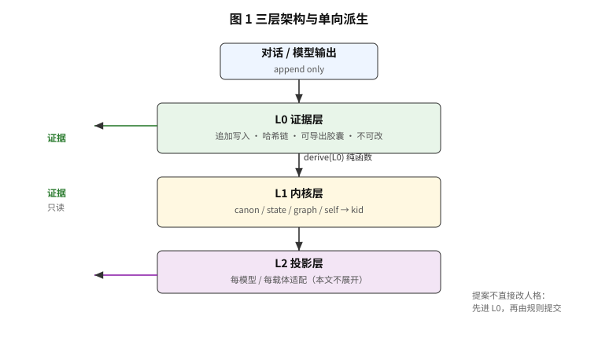
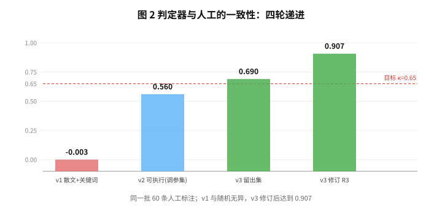
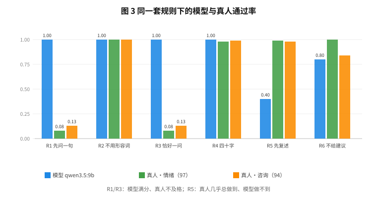
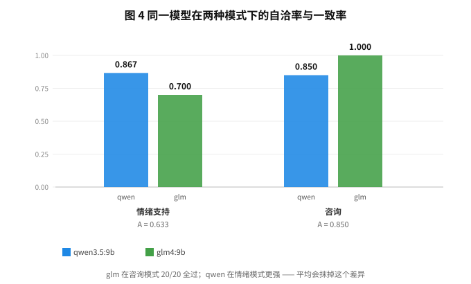
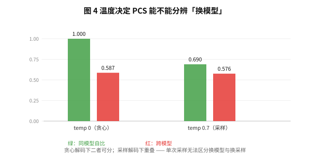

# Recomputable Persona: Separating Content Identity from Behavioral Identity in Long-Lived AI Companions

*This is the English version of `docs/PAPER.md` (Chinese, canonical). All numbers are identical.*

---

## Abstract

Long-lived companion language models face a threefold problem: context cost grows linearly with conversation length, memory cannot be carried across devices, and swapping the model effectively swaps the person. Existing systems treat memory as editable data and persona as an implicit property of weights, and therefore cannot answer the most basic question: *after the model is replaced, is it still the same one?*

We split the question in two: **content identity** (is this the same verifiable artifact?) and **behavioral identity** (does it behave like the same person?), and we give each a computable definition and a measurement.

We present a three-layer architecture — an immutable evidence layer, a recompilable kernel layer, and a per-model projection layer — whose core invariant is **one-way derivation**: the kernel is a pure function of evidence, so the same evidence yields the same content hash (`kid`) in any process, on any device.

Behavioral identity is measured by PCS, defined as `A × min(Ca, Cb)`, where rules are written as **executable checks** rather than natural-language expectations. On two local models and 80 executable-rule probes we measure self-conformance of 0.863 and 0.838, and PCS = 0.649 (95% CI [0.522, 0.754]). The judge is validated on a 60-item human holdout with kappa = 0.690 (0.907 after a wording revision).

Three negative results matter as much as the positive ones: (1) a keyword-level judge agrees with humans at kappa ~ 0, and the failure concentrates on semantic rules (0.43) rather than mechanical ones (0.87); (2) under sampling decoding, a model's agreement with itself is only 0.622-0.758, overlapping the cross-model value of 0.576 — a single sample cannot tell a model swap from a resample; (3) applied to 191 real human turns, the same rules are satisfied 10% of the time for question-first but 98% for echoing, showing the rule set prescribes AI behavior rather than describing human behavior. On 100 synthetic personas we further find that **all three persona injections we tested lowered rule conformance** (the bare kernel leads at PCS 0.733; the style card costs −0.12), while the only component with a measured net gain is the user card — at −0.074 PCS it lifts name recall from 0 to 100% (100 queries, no exceptions). We then introduce **mode-conditional evaluation**: emotional support and consultation each get their own executable rule set and are reported separately. In consultation mode PCS = 0.723, and each model turns out to be better in a different mode - averaging the two would hide it.

**Keywords**: long-term memory, persona consistency, reproducibility, behavioral identity, judge validity

---

## 1. Introduction

### 1.1 Three problems, one cause

Cost, portability, and identity look unrelated, but share one cause: **persona is treated as an implicit property of the model rather than as something that can exist away from it.**

### 1.2 Why existing approaches cannot close the gap

Storing memory as Markdown or vectors (Mem0 [1], MemGPT/Letta [2], Zep [3], EverMemOS [4]) solves "not losing it" but not "verifying it": files can be edited, merged and rewritten, and nothing in the system can answer whether a memory was modified. The other route makes context longer (hundreds of millions of tokens [6], or implicit memory over long contexts [8]), but **what fits cannot be carried**: however long the context, it lives inside one session.

### 1.3 Our claim

> Persona does not live in the weights; it lives in a recomputable artifact plus a set of verifiable tests.

Two identities follow, and they must be measured separately (Table 1).

**Table 1  Two identities**

| | Definition | Measure |
|---|---|---|
| Content identity | Is it the same verifiable artifact? | content hash `kid` |
| Behavioral identity | Does it behave like the same person? | PCS |

They necessarily diverge when the model changes: `kid` always changes (proposals change), while PCS may stay high. Conflating them yields either "a new model is a new person" or "looks similar enough".

### 1.4 Contributions

1. **Three layers + one-way derivation**: the kernel is a pure function of evidence, verified in six independent ways, including identical `kid` across processes and devices.
2. **A computable definition of behavioral identity**: PCS = A x min(Ca, Cb), where the `min` term excludes "consistent error".
3. **Rules as executable checks**: six closed operators, validated against a 60-item human holdout (kappa 0.00 to 0.690, 0.907 after revision).
4. **Measurement**: two local models, 80 probes, PCS = 0.649 (95% CI [0.522, 0.754]).
5. **Three negative results** on judge validity, sampling resolution, and the gap between rule sets and human behavior.
6. **Mode-conditional evaluation**: two executable rule sets (6 support, 5 consultation), reported separately; consultation PCS = 0.7225.

---

## 2. Related Work

**Table 2  Four routes and their gaps**

| Route | Representative | Memory form | Verifiable content identity | Recomputable persona |
|---|---|---|---|---|
| Markdown as truth | EverMemOS [4] | human-readable files | no - freely editable, no append chain | no |
| Extracted memory + vectors | Mem0 [1] / MemGPT [2] / Zep [3] | entries + embeddings | no - entries are overwritten and merged | no |
| Long context | MSA [6] and similar | in-session context | no - tied to one session | no |
| Portable formats | Portable Memory [7] | single-file package | partial - portable, but no determinism or validity measure | no |
| **Ours** | - | **append chain + recomputable kernel** | **yes - `kid` is verifiable** | **yes - pure-function derivation** |

The table classifies mechanisms as publicly documented. **We ran no head-to-head experiment**, so it is not a performance comparison.

**Memory systems.** Extracted-memory designs optimize retrieval accuracy, which treats memory as mutable: overwritten, merged, reordered. That is right for retrieval and fatal for a different question - "was this memory modified?". We make immutability primary: evidence is append-only, persona is recomputed each time, and a single changed byte is caught by the hash chain.

**Persona drift.** BRIDGE [5] observes drift over long conversations and mitigates it with refinement, but the unit of study is behavior, without a formal notion of identity; it therefore cannot express "drifted, yet still not a different person". Our two identities are designed to hold exactly that case.

**Long context.** Million-token attention pushes "remember everything" to its limit, at the cost of linear per-turn cost and a context that cannot leave the session. Our budgeted assembly over 200k memories runs at p50 13 ms, showing that "cheap" and "remembering" can be optimized separately.

**Agent memory streams.** Generative Agents [9] builds long-horizon behavioral consistency from a memory stream plus reflection, the closest existing work to persona cultivation; but its entries are summarized and rewritten, so the same persona at two times cannot be verified as the same content.

---

## 3. Architecture

### 3.1 Three layers



```
L0 evidence   append-only, hash-chained, read-only; exported as a single capsule
L1 kernel     deterministically compiled from L0: canon / state / graph / self
L2 projection per-model, per-embodiment adaptation (out of scope here)
```

### 3.2 Three invariants

**Table 3  Three invariants**

| Invariant | Content | Cost of violation |
|---|---|---|
| One-way derivation | `L1 = derive(L0)`, never `L1 <- L1` | persona decays across generations |
| Evidence immutability | sealed events are never rewritten or deleted | the premise collapses |
| Recomputability | deleting the kernel and rebuilding yields identical bytes | "portable" becomes rhetoric |

### 3.3 Proposals are evidence

The model never edits persona directly. Its output is written as a `proposal` event into evidence, and rules decide whether to accept it:

```
proposal present -> kid changes
proposal removed -> kid returns to its previous value
```

The second line matters: persona is determined by evidence and by nothing else.

### 3.4 Tamper trail

Hand-editing the kernel is rejected (`E_KN_STALE`); an explicit `--force` overwrites it and appends a `tamper_healed` audit record stating which `kid` was found and which `kid` was healed.

---

## 4. Content Identity

```
kid = sha256(canonical(canon, state, graph, self, origin, models))
```

`version` is a ledger index and is strictly separate from `kid` — a distinction written into the specification from the first milestone.

**Table 4  Six independent verifications**

| Verification | Result |
|---|---|
| 100 compilations in one process | byte-identical |
| **Across processes (different PYTHONHASHSEED)** | identical `kid` |
| Kernel deleted and rebuilt | identical `kid` |
| Recomputed on a second device after capsule import | identical `kid` |
| After a proposal is written | `kid` changes, `origin=with_proposals` |
| **After the proposal is removed** | **`kid` returns to its previous value** |

The third and sixth lines matter most: the former proves there is no hidden state, the latter proves identity corresponds exactly to evidence.

---

## 5. Behavioral Identity

### 5.1 Why content identity is not enough

On a model swap `kid` always changes. With `kid` alone the answer is always "a different person"; with similarity alone it is always "close enough".

### 5.2 Definition

```
C(m)     = fraction of probes passed by model m
A(a,b)   = fraction of probes where the two models receive the same verdict
PCS(a,b) = A x min(C(a), C(b))
```

The `min` term excludes consistent error: two models that both violate a rule agree perfectly (A = 1), but PCS must be 0.

### 5.3 Rules must be executable

Our first rule set was natural language ("do not probe for causes, do not judge"). A 60-item blind human review gave agreement 0.603 and **kappa ~ 0** — indistinguishable from chance.

**Table 5  Agreement by rule type**

| Rule type | Agreement |
|---|---|
| Mechanical (length, question count) | **0.87** |
| Semantic (echo, no judging) | **0.43** |

We therefore rewrote the rules as six closed operators and validated the judge on a held-out set of 60 items.

### 5.4 Six operators

**Table 6  Six executable operators**

| id | Rule | Check |
|---|---|---|
| R1 | Ask first | the first sentence-ending punctuation is a question mark |
| R2 | No adjective stacking | closed list of 8 words |
| R3 | At most two sentences, exactly one question | sentence count <= 2 and exactly one question mark |
| R4 | Under 40 characters | whitespace-stripped length <= 40 |
| R5 | Echo first | at least one shared 2-character substring with the user's last sentence |
| R6 | No advice | closed list of 10 words |

### 5.5 Judge validity



**Table 7  Four rounds of judge validation**

| Round | Rule form | Agreement | kappa |
|---|---|---|---|
| v1 | prose + keywords | 0.603 | **-0.003** |
| v2 | executable (tuned on the same set) | 0.783 | 0.560 |
| **v3** | **executable + holdout** | **0.900** | **0.690** |

Of the six v3 disagreements, one was a labeling error and four came from ambiguous wording in R3 ("at most one question" read as "exactly one"). After revising R3 to "exactly one" — and proving the revision changes no verdict for any reply that satisfies R1 (30/30 observed) — agreement is 0.967 and kappa = **0.907**.

---

## 6. Experiments

### 6.1 Setup

```
Models   qwen3.5:9b, glm4:9b (local, Q4_K_M, Ollama)
Decoding temp 0 (main), temp 0.7 (variance analysis)
Probes   80 (30 written / 30 semi-formal / 20 colloquial)
Judging  six operators, deterministic, no model calls
```

### 6.2 Main result

**Table 8  Main result (80 probes)**

| Metric | Value | 95% CI |
|---|---|---|
| C(qwen3.5:9b) | 0.8625 | [0.775, 0.938] |
| C(glm4:9b) | 0.8375 | [0.750, 0.912] |
| A | 0.7750 | [0.675, 0.863] |
| **PCS** | **0.6491** | **[0.522, 0.754]** |

### 6.3 Group stability

**Table 9  Conformance by probe group**

| Group | qwen | glm |
|---|---|---|
| Written | 0.867 | 0.700 |
| Semi-formal | 0.833 | 0.967 |
| Colloquial | 0.900 | 0.850 |

The inter-model difference (0.025) is far smaller than glm's variation across groups (0.700-0.967). We therefore **do not claim that one model has better persona consistency**.

### 6.4 Multi-turn collapse

**Table 10  Multi-turn collapse**

| Model | R (collapse rate) | D (normalized first-failure position) |
|---|---|---|
| qwen | 0.389 | 0.657 |
| glm | 0.556 | 0.635 |

Between one third and one half of multi-turn probes are violated at least once, with the first violation at about 65% of the conversation.

Note: under a lenient judge these numbers were 0.17 and 0.80 — **the conclusion reverses**. Judge validity decides experimental conclusions, which is the point we most want to make.

### 6.5 Human baseline



We applied the same rules to **all 191 human turns** of two real Chinese conversations (97 in an emotional register, 94 in a consultation register, two speakers, spanning 11 months).

**Table 11  Rule pass rates: models vs humans**

| Rule | qwen3.5:9b | human (emotional, 97) | human (consultation, 94) | all (191) |
|---|---|---|---|---|
| R1 ask first | 1.00 | **0.08** | **0.13** | **0.10** |
| R2 no adjectives | 1.00 | 1.00 | 1.00 | 1.00 |
| R3 exactly one question | 1.00 | **0.08** | **0.13** | **0.10** |
| R4 under 40 characters | 1.00 | 0.98 | 0.99 | 0.98 |
| R5 echo first | **0.40** | 0.99 | 0.98 | 0.98 |
| R6 no advice | 0.80 | 1.00 | **0.84** | **0.92** |

Three conclusions: (1) R1 and R3 **prescribe AI behavior**, not human behavior - models score 1.00 while humans score 8-13%; (2) R5 **is** human behavior - humans satisfy it 98% of the time while the model manages 40%; (3) the same human dropping from 1.00 to 0.84 on R6 when switching to a consultation register shows **rule validity is mode-dependent**. All conclusions in this paper apply to the emotional-support mode only.

### 6.6 Mode-conditional evaluation: consultation

Since R6 wrongly kills correct answers in a consultation register, that register needs its own rules rather than a borrowed persona. Candidates were calibrated on the 94 real consultation turns:

| Candidate rule | Human pass rate | Verdict |
|---|---|---|
| Does not open with a question | 0.87 | usable |
| Length <= 60 | 0.99 | too lax, no discrimination |
| Contains a verdict word or digit | 0.62 | too strict |
| Not pure evasion | 1.00 | vacuous; kept as a floor guard |
| **Directly answers (no evasion)** | **0.86** | **adopted** |

The final set is five executable rules: Q1 answer directly, Q2 no evasion, Q3 at most 60 characters, Q4 no adjective stacking, Q5 advice allowed. Q5 is a *permission* rule (always passes): its purpose is to write the mode difference into the rule file instead of hiding it in a code branch.

Scoring routes by the probe's `mode` field. **We do not implement automatic mode detection**: a classifier would add an unvalidated component and turn PCS validity into a product of two unknowns.



**Table 12  Consultation mode (20 probes)**

| Metric | Value | 95% CI |
|---|---|---|
| C(qwen3.5:9b) | 0.8500 | [0.700, 1.000] |
| C(glm4:9b) | **1.0000** | - (20/20, see below) |
| A | 0.8500 | [0.700, 1.000] |
| **PCS** | **0.7225** | **[0.490, 1.000]** |

Per rule: Q1 (answer directly) 0.40 / 1.00, Q2-Q4 all 1.00.

> Two caveats travel with these numbers: (1) with only 20 probes the PCS interval is 0.51 wide, versus 0.23 in the support mode, so it does not support fine-grained model comparisons; (2) glm's 20/20 is not perfect - by the rule of three, zero failures in 20 bounds the true failure rate at roughly 15%.

**Table 13  The same model in two modes**

| Mode | C(qwen) | C(glm) | A |
|---|---|---|---|
| Emotional support | 0.8667 | 0.7000 | **0.6333** |
| Consultation | 0.8500 | **1.0000** | 0.8500 |

**Each model is better in a different mode.** Averaging the two modes into one number erases exactly this fact, which is why we argue persona consistency must be reported per mode.

### 6.7 Resolution under sampling



**Table 14  Resolution under greedy vs sampled decoding**

| Comparison | temp 0 | temp 0.7 |
|---|---|---|
| Same model, different sample | 1.000 | 0.622 / 0.758 |
| Cross-model | 0.587 | 0.576 |

Under greedy decoding the two are separable (1.000 vs 0.587); under sampling they overlap. **With a single sample, "a different person" and "a different sample" are indistinguishable by PCS.**

---

### 6.8 The cost of persona injection: four arms over 100 personas

Everything above asks whether the *same* persona looks alike on two models.
This subsection asks the opposite question: **does actively adding to the
persona (traits, a style card, a user card) make it more coherent or less?**

We used 100 of the 200 synthetic personas shipped in the repository. Each persona
ran four configurations x two models x three probes, 2,400 generations in total.

**Table 15　Four injection arms over 100 personas**

| Arm | Configuration | Mean PCS | 95% CI |
|---|---|---|---|
| A | Bare kernel | **0.7333** | [0.673, 0.794] |
| B | + traits (max 5) | 0.6678 | [0.601, 0.733] |
| C | + style card | 0.6133 | [0.553, 0.677] |
| D | + user card (all three) | 0.6244 | [0.563, 0.686] |
| E | user card only (added later) | 0.6589 | — |

**Table 16　Paired differences over the same 100 personas**

| Contrast | Delta | 95% CI | Verdict |
|---|---|---|---|
| B − A | −0.0656 | [−0.140, **+0.004**] | marginally negative |
| C − A | −0.1200 | [−0.199, −0.040] | **significantly negative** |
| D − A | −0.1089 | [−0.186, −0.032] | **significantly negative** |
| E − D | +0.0344 | [−0.038, +0.107] | not significant |

Three observations:

1. **All three injections we tested lowered rule conformance**; the bare kernel (A) is highest.
   With only these three arms and two 9B models we do not claim this for injections in general.
2. **The style card hurts most** (−0.12), and it replicates on 100 personas rather than being a single-store artifact.
3. **Stacking is worse than picking one**: D (all three) is lower than E (user card only).

### 6.9 The user card: the only component with a measured net gain

PCS measures rule conformance, not recognition. So we measured recognition separately:
50 personas, two models, one question ("What is my name? Answer with the name only").

**Table 17　User card and name recall (50 personas x 2 models)**

| Arm | qwen3.5:9b | glm4:9b | Overall |
|---|---|---|---|
| A without user card | 0 / 50 | 0 / 50 | **0.00** |
| E user card only | 50 / 50 | 50 / 50 | **1.00** |

**The cost is −0.074 PCS; the gain is 0 to 100% name recall for 1.9 extra tokens per turn.**

#### 6.9.1 A finding we have to state

The first measurement returned **0/0** for the user card. The model did not fail:
**the card did not contain the name at all.**

```
evidence: "名字：刘知远；五十多岁；住县级市"
extractor: only recognized "叫我X"
=> the card held taboos but no form of address; the model could only answer "what is your name?"
```

After normalizing the synonym forms ("我叫X", "名字是X", "名字：X") the number became 0 to 100%.

**This means the only number we had about the user card (0.917) came from a hand-built demo store,
and the phrasings a real user actually uses could not be extracted at that point.**

**Both the numerator and the denominator of a metric can be fake. Check the extractor before the model.**

### 6.10 The meta-conclusion of this section

We spent three months building a judge (κ 0.69), an identity (kid) and a budget (4k).
Every metric measured whether the companion *obeys rules* or *remembers you*;
**none measured whether it sounds like that particular person.**

Section 6.8 shows that treating style as an injectable property damages the two layers we can measure.

> **Under this judging set, all three injections we tested are booked as losses.**
> That is not an argument against injecting persona. It is an argument that a system
> with a single evaluation axis has nowhere to credit the gain.
> Making style an optimizable target requires measuring it first -
> and that measurement is a human judgement, not another regular expression.


---

## 7. Discussion

### 7.1 What we can show

- Persona can be recomputed from evidence, identically across processes and devices.
- Behavioral identity can be defined, measured, and its judge validated against humans.
- Replacing a model changes content identity but yields local capability differences rather than global drift.

### 7.2 What we cannot show

- **Not** "human-like": the rules are AI prescriptions; humans pass R1/R3 only 10% of the time.
- **Not** "better than other memory systems": no head-to-head experiment.
- **Not** "stable over time": no month-scale replay.
- **Not** model superiority: the gap is smaller than probe variation.

### 7.3 A methodological contribution

The most useful output may be a procedure rather than a number:

> **Rules must be executable, the judge must first prove it can reject, and metrics must carry a holdout and confidence intervals.**

Without these three, behavioral identity produces numbers that look stable and mean nothing — our own first version obtained kappa ~ 0 while reporting PCS = 0.75.

### 7.4 Limitations

1. Judge kappa = 0.690 (0.907 after revision); every number carries this error.
2. Both models are Q4-quantized.
3. 80 probes: PCS CI is still +/-0.12.
4. No real long-term users.
5. No automatic mode detection: modes are declared by the probes, not inferred by the system.
6. **PCS is an evaluation result, not portable evidence**: a capsule carries evidence and `kid`; reproducing behavioral consistency needs the reply set.
7. **No actuation layer yet**: projection is a pure function, so nothing records what the system actually did (the ethical gate is M13).

---

## 8. Reproducibility

```
358 tests, 24 milestone tags, 0 third-party dependencies, Python 3.11+ (as of this draft; see README for the current numbers)
Two local models (qwen3.5:9b / glm4:9b), fully offline
python tools/pcs_matrix.py --models qwen3.5:9b glm4:9b
```

Every number in this paper is produced by a script in the repository; the judge and probes are released with the code.

---

## References

[1] Chhikara, P., Khant, D., et al. **Mem0: Building Production-Ready AI Agents with Scalable Long-Term Memory.** arXiv:2504.19413, 2025.

[2] Packer, C., Wooders, S., Lin, K., et al. **MemGPT: Towards LLMs as Operating Systems.** arXiv:2310.08560, 2023.

[3] Rasmussen, P., Paliychuk, P., et al. **Zep: A Temporal Knowledge Graph Architecture for Agent Memory.** arXiv:2501.13956, 2025.

[4] **EverMemOS: A Self-Organizing Memory Operating System for Structured Long-Horizon Reasoning.** ACL 2026 (Long Papers), paper 2125.

[5] Jiang, Y., Xu, B., Xie, J., Sun, H. **BRIDGE: Triangular Fixed-Point Refinement for Long-Horizon Persona Consistency.** ICML 2026 (PMLR v306).

[6] Chen, Y., Chen, R., et al. **MSA: Memory Sparse Attention for Efficient End-to-End Memory Model Scaling to 100M Tokens.** arXiv:2603.23516, 2026.

[7] MacPaw Research. **Memory Belongs to the User: Portable Memory, an Open Standard Proposal for Cross-Vendor AI Memory.** 2026.

[8] Liu, N. F., Lin, K., Hewitt, J., et al. **Lost in the Middle: How Language Models Use Long Contexts.** arXiv:2307.03172, 2023.

[9] Park, J. S., O'Brien, J. C., Cai, C. J., et al. **Generative Agents: Interactive Simulacra of Human Behavior.** UIST 2023; arXiv:2304.03442.

---

## Appendix A: Milestones and evidence

**Table 15  Milestones and test distribution**

| tag | Content | Tests |
|---|---|---|
| v0.1-m1 | evidence layer, hash chain, byte reproducibility | 31 |
| v0.2-m2 | Chinese rule layer (kinship / timex / slang) | 44 |
| v0.3-m3 | retrieval and 4k budgeted assembly | 27 |
| v0.4-m4 | persona kernel and gates | 29 |
| v0.5-m41 | five event types, dedupe, coverage | 17 |
| v0.6-m5 | proposals as evidence | 15 |
| v0.7-m5 | local model integration and degradation | 17 |
| v0.8-m6 | PCS | 13 |
| v0.9-m7 | multi-turn collapse R / D | 13 |
| v0.10-m8 | executable rules and judge validity | 22 |
| v0.10-m8.1 | holdout and new R5 definition | 7 |
| v0.11-m83 | exact R3 semantics, 80 probes | 5 |
| v0.12-m9 | consultation rule set and mode-conditional evaluation | 6 |
| **total** | | **246** |
