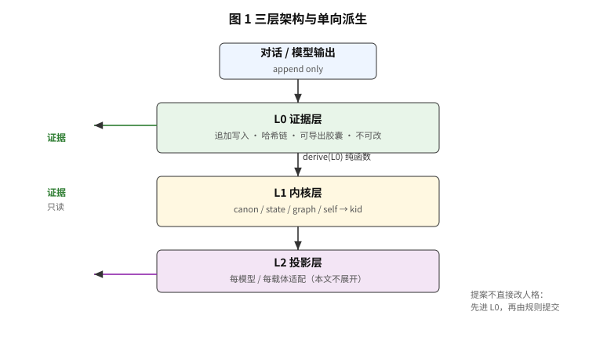
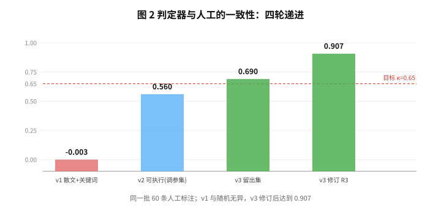
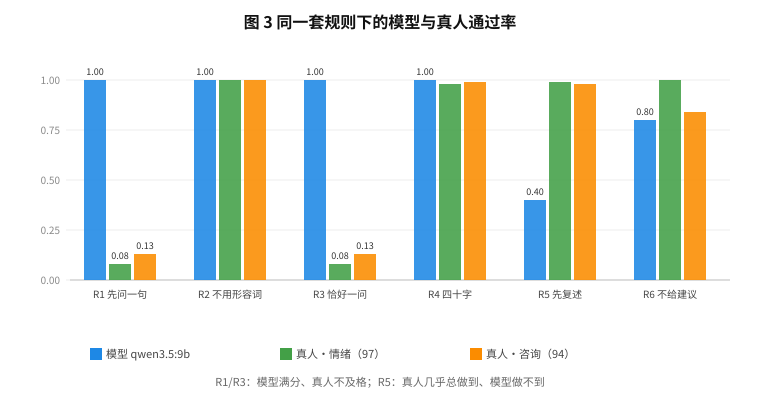
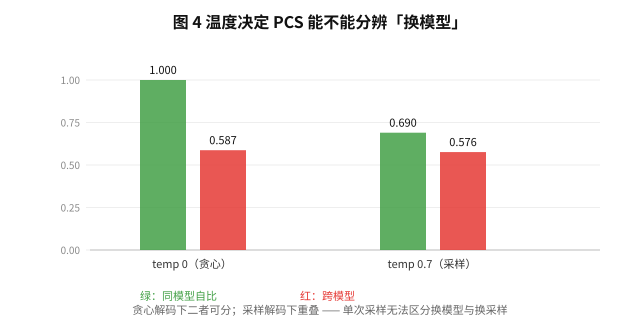

# 可重算的人格：把内容身份与行为身份分开测量

**Recomputable Persona: Separating Content Identity from Behavioral Identity in Long-Lived AI Companions**

---

## 摘要

长期陪伴型语言模型面临三重困境：上下文成本随对话线性增长、记忆无法跨设备携带、换一个模型就等于换一个人。
现有方案把记忆当作可编辑的数据、把人格当作模型的隐式属性，因而无法回答一个最基本的问题——**换掉模型之后，它还是不是原来那个它**。

本文提出把问题一分为二：**内容身份**（是否是同一份可验证的产物）与**行为身份**（表现得是否同一个人），并分别给出可计算的定义与实测。
我们给出一个三层架构——不可变证据层、可重算内核层、每模型投影层——其核心不变量是**单向派生**：内核对证据是纯函数，同一份证据在任何进程、任何设备上重算得到同一个内容哈希（kid）。
行为身份由 PCS 度量：`PCS = 一致率 × min(自洽率)`，其中规则被写成**可执行判定**而非自然语言期望。

在两个本地模型、80 条可执行规则探针上，我们测得自洽率 0.863 / 0.838，PCS = 0.649（95% CI [0.522, 0.754]）；判定器经 60 条人工留出集盲评，κ = 0.690。
三个负面结果同样重要：（1）关键词级判定器与人工一致性 κ≈0，失败集中在语义规则（0.43）而非机械规则（0.87）；
（2）同一模型在采样解码下的自比仅 0.622–0.758，与跨模型的 0.576 重叠，即**单次采样下无法区分换模型与换采样**；
（3）把同一套规则套到 191 条真人回复上，真人几乎不满足「先问一句」（10%）却高度满足「先复述」（98%），说明该规则集是对 AI 的规定而非对人类行为的描述。

**关键词**：长期记忆、人格一致性、可复现性、行为身份、判定器效度

---

## 1. 引言

### 1.1 三重困境

一个被长期使用的 AI 伙伴会遇到三件事：

```
成本    每轮都要重读上下文；对话越长，token 越多
迁移    记忆留在某个服务商的库里，换设备就断
身份    换一个模型，说话方式、取舍、边界全变了
```

三者看似无关，根因却是同一个：**人格被当作模型的隐式属性，而不是一份可以离开模型存在的东西。**

### 1.2 现有方案为何绕不开

把记忆存成 Markdown 或向量库（Mem0、Letta、Zep、EverMemOS 一类）解决了「不丢」，但没有解决「可验证」。
文件可以被编辑、被改写、被合并，没有任何机制能回答「这份记忆有没有被改过」。
另一条路线是把上下文做长（百万级 token 注意力），但**塞得起也带不走**：上下文再长，仍然活在一次会话里。

### 1.3 本文的主张

```
人格不活在权重里，而活在一份可以重算的产物 + 一组可以验证的测试里
```

由此得到两条必须分开测量的身份：

| | 定义 | 度量 |
|---|---|---|
| 内容身份 | 是不是同一份可验证的产物 | 内容哈希 kid |
| 行为身份 | 表现得是不是同一个人 | PCS |

**这两件事在换模型时必然分离**：kid 一定会变（提案变了），而 PCS 可能仍然高。
把它们混为一谈，就会得出「换个模型就不是同一个人」或「看起来像就行」两种错误结论。

### 1.4 贡献

1. **三层架构 + 单向派生**：内核对证据是纯函数，跨进程、跨设备重算得到同一 kid（六项独立验证）
2. **行为身份的可计算定义**：`PCS = 一致率 × min(自洽率)`，其中 `min` 项排除「一致的错」
3. **规则可执行化**：把人格规则写成六个封闭算子，并用 60 条人工留出集验证判定器（κ 从 0.00 提升到 0.690，修订后 0.907）
4. **实测**：两个本地模型、80 条探针，PCS = 0.649（95% CI [0.522, 0.754]）
5. **三个负面结果**：判定器效度的必要性、采样解码下的分辨力消失、规则集与人类行为的偏离

---

## 2. 相关工作

### 2.1 四条路线与它们的缺口

| 路线 | 代表 | 记忆形态 | 可验证内容身份 | 人格可重算 |
|---|---|---|---|---|
| Markdown 即真相 | EverMemOS 一类 | 人类可读文件 | ✗ 可被随意编辑，无追加链 | ✗ |
| 抽取式记忆 + 向量库 | Mem0 / Letta / Zep | 记忆条目 + embedding | ✗ 条目可被覆盖与合并 | ✗ |
| 长上下文 | 百万 token 级注意力 | 会话内上下文 | ✗ 依附于一次会话 | ✗ |
| 便携格式 | Portable Memory 一类 | 单文件封装 | ~ 可搬，但无确定性与效度度量 | ✗ |
| **本文** | — | **追加链 + 可重算内核** | **✓ kid 可验证** | **✓ 纯函数派生** |

注：本表按公开文档对机制的描述归类，**未做横向实验**，因此不构成性能比较。

### 2.2 逐条讨论

**记忆系统。** 抽取式方案的核心指标是「取回得准」，因此记忆被当作可变的数据结构：可覆盖、可合并、可重排。
这在检索上是对的，但它使一个基本问题失去意义——「这条记忆有没有被改过」。
本文把「不可变」作为第一性：证据只追加，人格每次从证据重算，改一个字节即被哈希链发现。

**人格漂移。** BRIDGE、MENTOR 等工作观察到长对话中的人格漂移，但研究单位是行为观察，
缺少「身份」的形式化定义——也就无法回答「漂移了但没有变成另一个人」这种情形。
本文把身份拆成内容身份与行为身份两个可计算量，正是为了容纳这种情形。

**长上下文。** 百万 token 注意力把「记得住」推向极致，代价是每轮成本随对话线性增长，且上下文无法离开会话。
本文的 4k 预算装配在 20 万条记忆上测得 p50 13ms，说明「便宜」与「记得住」可以分开优化。

**可复现性。** 本文把可复现当作一等公民而非附录：240 个测试、11 个里程碑标签、零第三方依赖、两个本地模型，
所有进入正文的数字都由仓库内脚本生成。

---

## 3. 架构

### 3.1 三层



```
L0 证据层   追加写入、哈希链、只读；导出为单一胶囊文件
L1 内核层   从 L0 确定性编译：canon / state / graph / self
L2 投影层   每模型、每载体的适配（本文不展开）
```

### 3.2 三条不变量

| 不变量 | 内容 | 违反的后果 |
|---|---|---|
| **单向派生** | `L1 = derive(L0)`，永不 `L1 ← L1` | 人格逐代腐坏 |
| **证据不可变** | 已封存事件永不改写、永不删除 | 整个前提塌掉 |
| **可重算** | 删除内核后可由证据完全重建，字节一致 | 「可迁移」变成修辞 |

### 3.3 提案即证据

模型不直接修改人格。它的输出被写成 `proposal` 事件进入证据层，再由规则决定是否采纳：

```
提案在 → kid 变
提案删 → kid 回到原值
```

第二条是关键：它说明**人格由证据唯一决定**，不多不少。

### 3.4 篡改留痕

手改内核会被拒绝（`E_KN_STALE`）；显式 `--force` 才覆盖，并追加一条 `tamper_healed` 审计记录，
记录「被改成了什么 kid」与「治愈成了什么 kid」。

---

## 4. 内容身份：可重算性

### 4.1 定义

```
kid = sha256(canonical(canon, state, graph, self, origin, models))
```

`version` 是账本序号，与 `kid` 严格分离——这是我们从第一版就写进规格的区分。

### 4.2 六项验证

| 验证 | 结果 |
|---|---|
| 同进程编译 100 次 | 字节一致 |
| **跨进程（不同 PYTHONHASHSEED）** | kid 相同 |
| 删除内核后重建 | kid 相同 |
| 设备 B 导入胶囊后重算 | kid 相同 |
| 提案写入后 | kid 变化，`origin=with_proposals` |
| **提案删除后** | **kid 回到原值** |

第三、六项最重要：前者证明没有隐藏状态，后者证明身份与证据一一对应。

---

## 5. 行为身份：PCS

### 5.1 为什么内容身份不够

换模型时 `kid` 必然改变。若只有 kid，结论永远是「换了个人」；若只有相似度，结论永远是「看起来差不多」。

### 5.2 定义

```
C(m)     = 该模型通过的探针比例（自洽率）
A(a,b)   = 两个模型判定结果相同的探针比例（一致率）
PCS(a,b) = A × min(C(a), C(b))
```

`min` 项用于排除「一致的错」：两个模型同时违反规则时 A=1，但 PCS 应为 0。

### 5.3 规则必须可执行

我们最初的规则是自然语言（「不追问原因、不评价对错」）。
60 条人工盲评显示：判定器与人的一致率 0.603，**Cohen's κ ≈ 0**——与随机无异。

诊断很清楚：

| 规则类型 | 一致率 |
|---|---|
| 机械（字数、问题数） | **0.87** |
| 语义（复述、不评价） | **0.43** |

于是我们做了两件事：把规则改写成六个封闭算子；把判定器放到 60 条留出集上盲评。

### 5.4 六个算子

| id | 规则 | 判定 |
|---|---|---|
| R1 | 先问一句 | 第一个句末标点是「？」 |
| R2 | 不用形容词堆砌 | 8 词封闭表 |
| R3 | 两句以内，恰好一问 | 句数 ≤2 且「？」恰好 1 个 |
| R4 | 四十字以内 | 去空白后 ≤40 字符 |
| R5 | 先复述 | 与用户末句存在 ≥2 字公共子串 |
| R6 | 不给建议 | 10 词封闭表 |

### 5.5 判定器效度



| 轮次 | 规则形态 | 一致率 | κ |
|---|---|---|---|
| v1 | 散文 + 关键词 | 0.603 | **-0.003** |
| v2 | 可执行（同批调参） | 0.783 | 0.560 |
| **v3** | **可执行 + 留出集** | **0.900** | **0.690** |

v3 的 6 条分歧经复核：1 条为标注错误、4 条源于 R3 措辞歧义（「不超过一个问号」被读作「必须问一个」）。
修订 R3 为「恰好一问」后（并证明对满足 R1 的回复两种读法判定一致，实测 30/30），一致率 0.967、κ = **0.907**。

---

## 6. 实验

### 6.1 设置

```
模型      qwen3.5:9b、glm4:9b（本地，Q4_K_M，Ollama）
解码      temp 0（主实验），temp 0.7（方差分析）
探针      80 条（书面 30 / 半书面 30 / 口语 20）
判定      六算子，确定性，零模型
```

### 6.2 主结果

| 指标 | 值 | 95% CI |
|---|---|---|
| C(qwen3.5:9b) | 0.8625 | [0.775, 0.938] |
| C(glm4:9b) | 0.8375 | [0.750, 0.912] |
| A | 0.7750 | [0.675, 0.863] |
| **PCS** | **0.6491** | **[0.522, 0.754]** |

### 6.3 分组稳定性

| 分组 | qwen | glm |
|---|---|---|
| 书面 | 0.867 | 0.700 |
| 半书面 | 0.833 | 0.967 |
| 口语 | 0.900 | 0.850 |

模型间差异（0.025）**远小于** glm 跨组波动（0.700–0.967）。
因此本文不宣称任一模型在人格一致性上更优。

### 6.4 多轮坍塌

| 模型 | R（坍塌率） | D（归一化首崩位置） |
|---|---|---|
| qwen | 0.389 | 0.657 |
| glm | 0.556 | 0.635 |

两个模型都有三分之一到一半的多轮探针至少违反一次，首次违反平均发生在全程 65% 处。

注：在宽松判定下这两个数是 0.17 / 0.80——**结论完全相反**。判定器效度决定实验结论，这是本文最强调的一点。

### 6.5 人类基线

我们把同一套规则套到两段真实中文对话的**全部 191 条真人发言**上
（情绪对话 97 条 / 咨询对话 94 条，两位说话人，时间跨度 11 个月）。



| 规则 | 模型 qwen3.5:9b | 真人·情绪（97） | 真人·咨询（94） | 合计（191） |
|---|---|---|---|---|
| R1 先问一句 | 1.00 | **0.08** | **0.13** | **0.10** |
| R2 不用形容词 | 1.00 | 1.00 | 1.00 | 1.00 |
| R3 恰好一问 | 1.00 | **0.08** | **0.13** | **0.10** |
| R4 四十字以内 | 1.00 | 0.98 | 0.99 | 0.98 |
| R5 先复述 | **0.40** | 0.99 | 0.98 | 0.98 |
| R6 不给建议 | 0.80 | 1.00 | **0.84** | **0.92** |

两个结论：

1. **R1 / R3 是对 AI 的规定，不是对人类行为的描述。** 模型满分，真人只有 8–13%——
   真人聊天几乎不以问句开场，也几乎不会只问一个问题。
2. **R5 是人类常态。** 真人 98% 自然做到，模型只有 40%——
   在「先复述」这一条上，模型确实不如人。

第三个结论来自模式对比：同一位真人从情绪对话切换到咨询对话，
「不给建议」从 1.00 降到 0.84，被判失败的恰是「需要授权」这类**正确的专业回答**。
**规则有效性依赖会话模式**；本文全部结论只适用于情绪支持模式。

### 6.6 采样解码下的分辨力



| 比较 | temp 0 | temp 0.7 |
|---|---|---|
| 同模型自比 | 1.000 | 0.622 / 0.758 |
| 跨模型 | 0.587 | 0.576 |

贪心解码下二者可分（1.000 vs 0.587）；采样解码下**重叠**。
**单次采样时，「换了一个人」与「换了一次采样」在 PCS 上不可区分。**

---

## 7. 讨论

### 7.1 能证明什么

```
✓ 人格可由证据重算，且跨进程、跨设备一致
✓ 行为身份可定义、可测量、且判定器效度经过人工验证
✓ 换模型会改变内容身份，但只造成局部能力差异而非整体漂移
```

### 7.2 不能证明什么

```
✗ 不能说「像人」——规则是 AI 规定，真人通过率仅 10%
✗ 不能说「优于其他记忆系统」——未做横向实验
✗ 不能说「长期稳定」——未做跨月回放
✗ 不能宣称模型间优劣——差异小于探针波动
```

### 7.3 方法论贡献

我们认为最有价值的不是数字，而是一条做法：

> **规则必须可执行，判定器必须先证明能判错，指标必须带留出集与置信区间。**

没有这三条，行为身份的测量会得到看似稳定、实则无意义的数字——本文的第一版就得到过 κ≈0 而 PCS=0.75。

### 7.4 局限

1. 判定器 κ = 0.690（修订后 0.907），所有数字带此误差
2. 两个模型均为 Q4 量化，非满精度
3. 探针 80 条，CI 仍宽（PCS ±0.12）
4. 无真实用户长期数据
5. 未做咨询模式的规则集（本文全部结论限于情绪支持模式）

---

## 8. 复现性

```
240 个测试，11 个里程碑标签，0 第三方依赖，Python 3.11+
两个本地模型（qwen3.5:9b / glm4:9b），全部离线可跑
python tools/pcs_matrix.py --models qwen3.5:9b glm4:9b
```

所有进入本文的数字都由仓库内的脚本生成，判定器与探针随代码发布。

---

## 附录 A：里程碑与证据

| tag | 内容 | 测试 |
|---|---|---|
| v0.1-m1 | 证据层、哈希链、字节可复现 | 31 |
| v0.2-m2 | 中文规则层（称谓/时间/俚语） | 44 |
| v0.3-m3 | 检索与 4k 预算装配 | 27 |
| v0.4-m4 | 人格内核与门控 | 29 |
| v0.5-m41 | 五类事件、去重、覆盖度 | 17 |
| v0.6-m5 | 提案进证据 | 15 |
| v0.7-m5 | 本地模型接入与降级 | 17 |
| v0.8-m6 | PCS | 13 |
| v0.9-m7 | 多轮坍塌 R / D | 13 |
| v0.10-m8 | 规则可执行化与判定器效度 | 22 |
| v0.10-m8.1 | 留出集与 R5 新定义 | 7 |
| v0.11-m83 | R3 精确语义、探针 80 | 5 |
| **合计** | | **240** |

